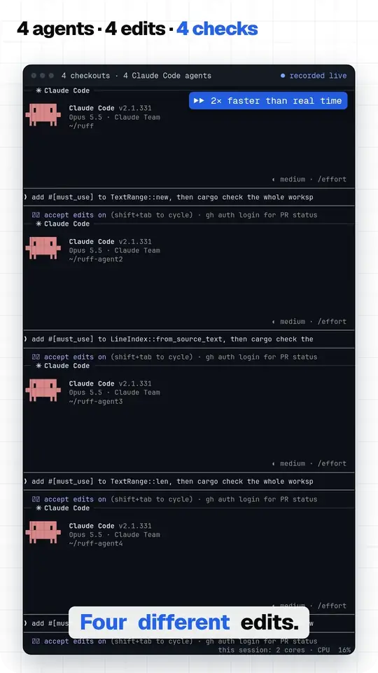

<p align="center">
  <a href="https://machinestream.io">
    <picture>
      <source media="(prefers-color-scheme: dark)" srcset="assets/machinestream-lockup-dark.png">
      <source media="(prefers-color-scheme: light)" srcset="assets/machinestream-lockup-light.png">
      
    </picture>
  </a>
</p>

<p align="center">
  <strong>Your agent's tests, type checks, linters and builds, run remotely.</strong><br>
  One small MCP server. The same exit code and output your machine gives.
</p>

<p align="center">
  <a href="LICENSE"></a>
  <a href="https://github.com/contextstream/machinestream-mcp/releases/latest"></a>
  
</p>

<br>

**macOS and Linux**

```sh
curl -fsSL https://machinestream.io/install.sh | sh
```

**Windows PowerShell**

```powershell
irm https://machinestream.io/install.ps1 | iex
```

The installer puts one binary on your machine, connects the MCP clients you pick, signs you in, and shows the price before anything is turned on. Then say to your agent: **"Run my tests with MachineStream."**

<br>

<p align="center">
  <a href="https://machinestream.io/media/four-agents.mp4">
    
  </a>
  <br>
  <sub>Four agents, four full workspace checks, none of them on your machine.<br><a href="https://machinestream.io/media/four-agents.mp4"><strong>Watch the film</strong></a> (61 seconds)</sub>
</p>

<br>

## What it does

[MachineStream](https://machinestream.io) runs a build, test, lint or type-check command remotely, on the exact state of your checkout: committed, uncommitted and untracked files. This server gives your agent that as five tools and nothing else.

```text
> check {"command": "cargo check"}

Failed (exit 101) in 0.2 s, ran remotely.
Run 20261125-043210-7b51. Full output (30 lines): ~/.cache/machinestream/runs/20261125-043210-7b51.log

Failures:
[diagnostics: 2 new failure(s), 0 base failure(s) suppressed]
- src/lib.rs:3:22 [E0308] mismatched types
- src/lib.rs:4:5 [E0308] mismatched types

Next: fix the failures and run the check again.
```

That is a real result: an uncommitted edit, checked remotely, with the compiler errors extracted as structured failures.

- **Exact.** A check sees your working tree as it is now, not your last commit.
- **Honest.** When the service cannot run a command faithfully it says so, and the command runs on your machine as it always did.
- **Free to repeat.** The same command on unchanged files comes back from the cache at no cost.

## Install

The two commands at the top are all most people need. Each one:

1. downloads the binary for your machine from this repository's [releases](https://github.com/contextstream/machinestream-mcp/releases) and checks it against the release's SHA-256 checksums;
2. installs it for your user, without `sudo` or administrator rights (`~/.local/bin` on macOS and Linux, `%LOCALAPPDATA%\MachineStream\bin` on Windows);
3. runs `machinestream-mcp setup`, which finds your MCP clients, connects the ones you pick, signs you in through the browser, shows the price and your balance, and turns remote checks on only after you say yes.

Run either command again to upgrade. You need git, and a ContextStream account (free to start; MachineStream runs through it).

| Option | Meaning |
| --- | --- |
| `MACHINESTREAM_VERSION=0.1.0` | Install that version, not the latest |
| `MACHINESTREAM_INSTALL_DIR=/some/bin` | Install there |
| `MACHINESTREAM_NO_SETUP=1` | Install only; run `machinestream-mcp setup` yourself later |
| `MACHINESTREAM_DRY_RUN=1` | Say what would be done, and do nothing |

<details>
<summary><strong>Other ways to install, and connecting one client by hand</strong></summary>

<br>

**From a release.** Download the binary for your platform from the [releases page](https://github.com/contextstream/machinestream-mcp/releases), check it against `SHA256SUMS`, make it executable and put it on your `PATH`.

**From source.** `cargo build --release`, then use `target/release/machinestream-mcp`.

**One client, in one project.** `setup` connects your clients user-wide. To add the server to a single project instead, run this in the project folder:

| Client | Command | File it writes |
| --- | --- | --- |
| Claude Code | `machinestream-mcp install claude-code` | `.mcp.json` |
| Cursor | `machinestream-mcp install cursor` | `.cursor/mcp.json` |
| VS Code | `machinestream-mcp install vscode` | `.vscode/mcp.json` |
| Gemini CLI | `machinestream-mcp install gemini-cli` | `.gemini/settings.json` |
| Codex | `machinestream-mcp install codex` | `~/.codex/config.toml` |
| Windsurf | `machinestream-mcp install windsurf` | `~/.codeium/windsurf/mcp_config.json` |
| Claude Desktop | `machinestream-mcp install claude-desktop` | Claude Desktop's own config |

`install` merges one entry into the client's own MCP file and leaves everything else in it alone. `--print` shows the entry without writing it. The entry is the same everywhere:

```json
{ "mcpServers": { "machinestream": { "command": "/path/to/machinestream-mcp", "args": [] } } }
```

</details>

If you already use the ContextStream MCP on this machine you are signed in: both read the same saved login.

## The tools

Every result leads with the answer and says what to do next. Every tool returns structured content next to the text.

### `check`

Run one command remotely.

```json
{ "command": "npx tsc --noEmit", "cwd": "web", "timeout_seconds": 600 }
```

While it runs, the newest output lines arrive as MCP progress notifications, and the call can be cancelled. The result is one status line (passed or failed, exit code, seconds, whether it came from the cache, where it ran), the failures the service extracted, and a bounded tail of the output. The full output is saved on your machine under a run id.

A failed check is a result, not a tool error. So is a check that was not run remotely: it comes back with `ran: false`, the reason, and "Run this command locally: ...".

<sub>Arguments: `command` (required), `cwd`, `timeout_seconds`, `fresh` (run again even if the same command already ran on exactly these files), `max_output_lines`.</sub>

### `check_parallel`

Run 2 to 8 commands at once, against one snapshot.

```json
{ "checks": [ { "command": "cargo fmt --check" }, { "command": "cargo clippy" }, { "command": "cargo test" } ] }
```

The snapshot is taken once and every command runs on it. The result is a one-line summary (`2 passed (1.0 s wall, one snapshot of the checkout).`, from a real run of `cargo check` and `cargo test`) and one block per command, failures first. This is the thing a shell cannot do for an agent: lint, types and tests in one call.

### `status`

Am I ready, and what will it cost?

```json
{}
```

Read-only and free. It reports the signed-in account, whether remote checks and the extra languages are on, the credit balance and the price, the languages the account can run, whether this folder is a git checkout a snapshot can be taken of, and the last five runs. When something is missing it names the exact next step.

### `setup`

Do the next missing step.

```json
{ "enable_remote_checks": true }
```

Safe to call at any time. Not signed in: it starts a browser sign-in and returns the link and the code. Signed in with remote checks off: it explains what turning them on means, with the price and your balance, and turns them on only when called with `enable_remote_checks: true`. The extra languages have their own switch, `enable_more_languages: true`. It never turns anything on or spends credits without the explicit argument.

### `run_output`

Read a saved run without running anything.

```json
{ "grep": "error\\[", "context": 2, "max_lines": 50 }
```

Defaults to the latest run. It takes `run_id`, `grep` (a regular expression), `context`, `head`, `tail` and `max_lines`. Saved runs are also MCP resources (`machinestream://runs/<id>`).

### Also in the box

- **A prompt, `verify-changes`.** It finds the project's checks, runs them with `check_parallel`, and summarises failures with file and line.
- **Instructions for the model**, sent when the client connects: use `check` instead of the shell for builds, tests, lints and type checks; run locally when a result says so; never send commands that deploy, publish or need secrets.
- **Tools your account's catalog defines.** If the service defines more tools for your account, they are listed beside these five exactly as the service describes them.

## MachineStream MCP or ContextStream MCP?

They use the same account and the same service. Pick by how much you want.

| | **MachineStream MCP** (this repository) | **[ContextStream MCP](https://github.com/contextstream/mcp-server)** |
| --- | --- | --- |
| What it is | Remote checks, and nothing else | The context platform for AI agents. It includes MachineStream |
| Remote builds, tests, lints and type checks | Yes | Yes |
| Finds the right files and recalls saved decisions | No | Yes |
| Tools your agent sees | Five | The full ContextStream set |
| Account | Your ContextStream account | The same account |
| Install | The two commands at the top of this page | See [its README](https://github.com/contextstream/mcp-server#readme) |
| Choose it when | You want your agent's checks off your machine, and only that | You also want your agent to know your code and the decisions behind it |

You can run both. They share the login and the account setting that turns checks on.

## What leaves your machine

A check starts from a snapshot of your checkout, taken by the same open-source engine the ContextStream MCP uses. See exactly what a check of the current folder would send, without sending it:

```sh
machinestream-mcp doctor --explain-upload
```

**Sent with each check**

- The command as written, the folder inside the repository it runs in, and time limits.
- Who the repository is: its folder name and a SHA-256 digest of its `origin` URL. The URL itself is never sent.
- Your checkout as git sees it on top of its last commit: the commit's tree id, the checkout's tree id, and for each changed, added or deleted path its name, mode and content hash. The contents of changed and added files go with the call.
- The checkout's absolute path, so paths in the output name your files.
- A description of the machine: operating system and CPU architecture, the number of CPUs, whether the process runs as root, the time zone's name, and for each tool the command uses the first line of its `--version` (user name, home folder name and host name removed, path-like words left out).
- Environment variables the service names for the command's language (for example `RUSTFLAGS`, `NODE_ENV`, `CI`), only when your session sets them. A variable whose name looks like a credential (`KEY`, `TOKEN`, `SECRET`, `PASSWORD`, `AUTH` and the like) is never sent, nor is a value that holds a URL with a login in it.

**Sent only when the service asks**

- Files of the last commit that the service does not hold yet. On a first check of a repository that can be most of the files git tracks.

**Sent once, when you sign in**

- The API key created for this machine is named after its host name, so you can tell your keys apart in your account.

**Never sent**

- Anything `.gitignore` leaves out, untracked `node_modules` folders, and Cargo's `target` folder.
- A changed or new file that looks like a credential: `.env` files, SSH and other private keys, service-account JSON, `.npmrc`, `.pypirc`, `.netrc` and similar. Those paths are withheld, and the result names them. Paths listed in `.contextignore` or `.contextstream/ignore` are withheld too.
- Your API key. It authenticates to the API only. The stream a check runs on gets a token for that one call.

Files that are already committed are not withheld: if the service asks for the last commit's files, a committed credential goes with them, because it is in your history already.

**Limits and switches**

- Up to 4,000 changed files per check, 64 MiB in all and 16 MiB per file. Over a limit, the check runs on your machine.
- `CONTEXTSTREAM_CHECKOUT_SNAPSHOT=off` never takes a snapshot. `CONTEXTSTREAM_HOSTED_TOOLS=off` keeps every check on this machine. `CONTEXTSTREAM_HOSTED_ENV=off` sends no description of the machine. (These are the engine's own switches, shared with the ContextStream MCP.)
- `"checkout_snapshot": false` in a repository's `.contextstream/config.json` turns snapshots off for everyone who works in it.

**Kept on your machine**

- The full output of each run, in `~/.cache/machinestream/runs` (readable by you only; the newest 50 runs, at most 200 MB).

More on how checks are kept apart on the service: [machinestream.io/security](https://machinestream.io/security). The public description of what a check sends: [machinestream.io/docs#data](https://machinestream.io/docs#data).

## Pricing

Remote checks are paid with your ContextStream account's Context Credits, by remote command time, rounded up per check. Results served from the cache, checks that never start, checks handed back to your machine and local runs cost nothing. The current price is on [machinestream.io/pricing](https://machinestream.io/pricing); `status` shows the price the API publishes for your account and your balance.

Every check result carries a `billing` block with an estimate (`credits_estimated`, `billable_seconds`, `free_reason`). It is computed on the client from the published price. Your account's ledger is the authority.

## When a check is not run remotely

MachineStream is built around one rule: give back the same exit code, the same passes and failures and the same output your machine would. When the service cannot promise that, it does not guess. The result says `ran: false`, gives the reason in plain words, and says which command to run locally. That happens when, for example:

- the command is not a shape the service takes, or it would change your source files;
- the project needs a tool version or environment the service cannot match;
- an install would need your credentials or a source other than a package registry;
- the account is out of credits, or the service cannot be reached.

By default the server never runs anything on your machine: your agent runs the command itself, with its usual permissions. If you want the server to do it, set `MACHINESTREAM_LOCAL_FALLBACK=1`; the status line then says the command ran locally and why.

## The command line

The same binary is a CLI for people and CI.

```sh
machinestream-mcp                      # the MCP server on stdin and stdout
machinestream-mcp setup                # connect your clients, sign in, get ready
machinestream-mcp status [--json]      # ready or not, price, balance, recent runs (exit 0 when ready)
machinestream-mcp run -- cargo test    # run remotely, stream the output, exit with the command's status
machinestream-mcp doctor [--explain-upload]
machinestream-mcp install <client> [--print] [--global]
machinestream-mcp login                # sign in through the browser
machinestream-mcp logout               # forget the saved login
machinestream-mcp serve --http 127.0.0.1:8808 --root /path/to/checkout
```

`run` falls back to this machine when the command is not run remotely, as the shell would have run it. `--no-local` exits with status 75 instead.

`setup` takes `--yes` (connect every client found, never turn on anything that costs), `--client a,b`, `--enable-remote-checks` and `--skip-login` for scripts.

## Configuration

| Variable | Meaning |
| --- | --- |
| `MACHINESTREAM_API_KEY` | Your account's API key. `CONTEXTSTREAM_API_KEY` works too. Without either, the saved login is used. |
| `MACHINESTREAM_API_URL` | API base URL (default `https://api.contextstream.io`). `CONTEXTSTREAM_API_URL` works too. |
| `MACHINESTREAM_ROOT` | The checkout checks are about, for clients that do not start servers in the project folder. Same as `--root`. |
| `MACHINESTREAM_LOCAL_FALLBACK` | `1` lets the server run a turned-away command on this machine. Off by default, and always off over HTTP. |
| `MACHINESTREAM_USAGE_LOG` | A file that gets one JSON line per check, for per-use billing (see [docs/marketplaces.md](docs/marketplaces.md)). |
| `MACHINESTREAM_LOG` | `debug` writes structured logs to stderr. Nothing but protocol is ever written to stdout. |
| `MACHINESTREAM_CACHE_DIR` | Where saved runs are kept (default `~/.cache/machinestream`). |
| `MACHINESTREAM_SETUP_WAIT_SECONDS` | How long a `setup` tool call waits for the browser approval (default 50). |

The key is never printed. Logs and error messages show a short fingerprint of it instead.

## Hosting it for others

`serve --http` is the same server over Streamable HTTP, for container platforms and cloud agents. Each request carries its account's key in `Authorization: Bearer`, so one process can serve several accounts; the folder a session works in comes from the `--root` allowlist. [docs/marketplaces.md](docs/marketplaces.md) describes the ways to offer it and what each needs.

## FAQ

**Do I need an account?** Yes. MachineStream runs through a ContextStream account, and remote checks are off until you turn them on. `setup` does both steps.

**Which languages and tools?** `status` lists the languages your account can run, as the API reports them. The versions and tools are on [machinestream.io/docs/support](https://machinestream.io/docs/support).

**Why did my check come back "not run remotely"?** The result gives the service's reason word for word. The usual ones are in [When a check is not run remotely](#when-a-check-is-not-run-remotely).

**Will a result differ from my machine?** That is the one thing MachineStream is built not to do. When the service cannot match your machine it hands the check back.

**What if MachineStream is down?** Checks answer "run it locally", and your agent runs them as before. Nothing waits on the service.

**Can this server run commands on my machine?** Not unless you set `MACHINESTREAM_LOCAL_FALLBACK=1`.

**Where do checks run?** On Linux, in an isolated environment of your account's own. A project that needs macOS or Windows to build or test should run those checks locally.

**How do I upgrade or remove it?** Run the install command again to upgrade. To remove it, delete the binary and the `machinestream` entry from your client's MCP file; `machinestream-mcp logout` forgets the saved login.

## Development

```sh
cargo build
cargo fmt --check && cargo clippy --all-targets -- -D warnings
cargo test          # unit tests, and the server against a fake API and stream on localhost
npm test            # the install scripts and the launcher
```

The parts that decide what a check sends and how its result is read (the snapshot, the stream protocol, the tool catalog, sign-in) are the engine crates of the open-source [`contextstream/mcp-server`](https://github.com/contextstream/mcp-server), pinned by tag. [docs/design.md](docs/design.md) explains the split. See also [CONTRIBUTING.md](CONTRIBUTING.md) and [SECURITY.md](SECURITY.md).

## License

MIT. See [LICENSE](LICENSE).
